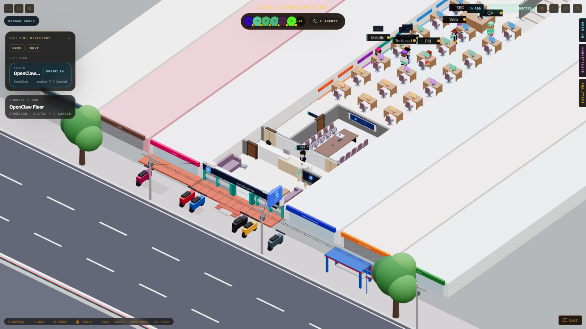
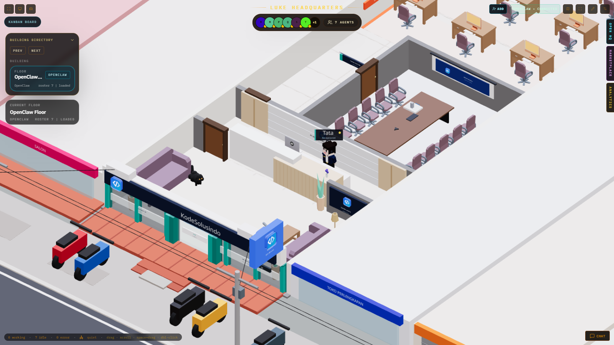
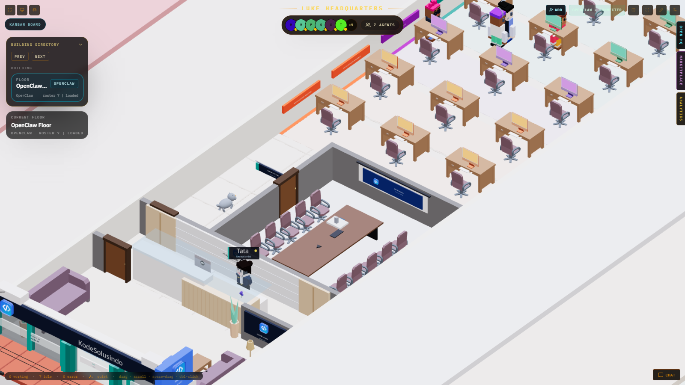
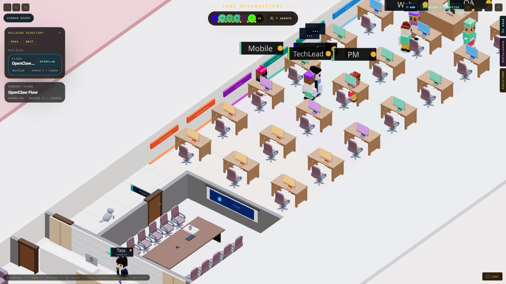
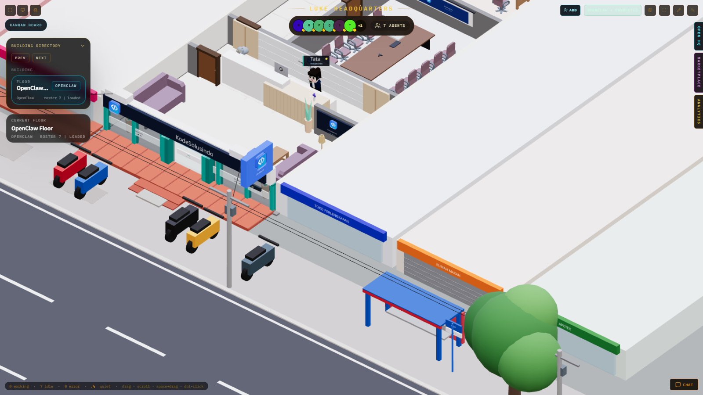

# Kantor AI KDS — PT Kode Digital Solusindo

Kantor virtual 3D untuk tim agen AI PT Kode Digital Solusindo (software house, Medan).
Dibangun di atas [Claw3D](https://github.com/iamlukethedev/Claw3D) (lisensi MIT) dan terhubung ke
[OpenClaw](https://docs.openclaw.ai) sebagai runtime agen.

Lantai 1 dimodelkan dari ruko kantor KDS di Jl. Gatot Subroto, Medan: **fasad 6 m menghadap jalan, panjang 30 m**,
diapit ruko tetangga selebar 4 m.

## Screenshot

| | |
|---|---|
|  |  |
| Overview ruko & jalan | Lobi, resepsionis, ruang tunggu |
|  |  |
| Ruang meeting (10 kursi + proyektor) & Tata | Area kerja 21 meja dengan iMac per tim |
|  | |
| Fasad, teras, jalan & halte | |

## Isi lantai 1

- **Fasad**: kaca + mullion teal, pintu lipat, fascia ACP navy "KodeSolusindo", blade sign logo dua sisi, teras terakota, motor, jalan, halte, pohon, tiang & kabel listrik.
- **Ruang tunggu**: sofa, meja, dispenser, tanaman, lampu (susunan diatur sendiri oleh pemilik — jangan diubah).
- **Resepsionis**: front desk gaya hotel (blok putih glossy + kayu oak) mengisi penuh bukaan sekat, backdrop logo & nama PT,
  dan **Tata** — resepsionis penerima tamu (NPC) yang selalu standby dan menyapa.
- **Ruang meeting**: meja persegi panjang 1,1 × 2,8 m, 10 kursi, layar proyektor di dinding belakang, proyektor plafon,
  papan nama "RUANG MEETING" di luar ruangan.
- **Area kerja**: 7 baris × 3 meja, iMac berwarna per tim (Mobile, Web, QA & UI/UX, SEO & Marketing), karpet & papan tim.
- **Belakang**: pantry, toilet, ruang server, tangga ke lantai 2.
- 2 kucing (British Shorthair abu-abu & Persia hitam) berkeliaran dari lobi sampai kantor.

## Agen (OpenClaw)

| Nama di kantor | Peran | Model |
|---|---|---|
| PM | Project Manager | DeepSeek |
| TechLead | Tech Lead (agen senior) | Claude Sonnet |
| Mobile | Mobile Developer | DeepSeek |
| Web | Web Developer | DeepSeek |
| QA | QA Engineer | DeepSeek |
| SEO | SEO Specialist | DeepSeek |
| main | agen bawaan | DeepSeek |

## Perubahan dari Claw3D upstream

| File | Perubahan |
|---|---|
| `src/features/retro-office/core/furnitureDefaults.ts` | Preset layout `kds_ruko` (skala 1 m = 58 satuan) |
| `src/features/retro-office/scene/kdsRuko.tsx` | Scene ruko: interior, fasad, jalan, tetangga, signage |
| `src/features/retro-office/scene/kdsReceptionist.tsx` | NPC resepsionis Tata |
| `src/features/retro-office/scene/kdsCats.tsx` | 2 kucing berkeliaran |
| `src/features/retro-office/objects/imac.tsx` | Model iMac berwarna + badge `</>` |
| `src/features/retro-office/objects/reception.tsx` | Front desk resepsionis |
| `src/features/retro-office/objects/meetingTable.tsx` | Meja meeting persegi panjang |
| `src/features/retro-office/RetroOffice3D.tsx`, `core/geometry.ts`, `core/navigation.ts` | Registrasi model & navigasi preset KDS |
| `src/lib/office/floors.ts` | Hanya lantai OpenClaw yang aktif |
| `server/gateway-proxy.js` | Proxy studio menandatangani koneksi dengan device identity sendiri + token server, sehingga token tidak pernah dikirim ke browser |
| `server/index.js` | `CLAW3D_LOCK_GATEWAY=1` mengunci upstream ke gateway dari env |

## Deploy (ringkas)

Contoh konfigurasi ada di [`deploy/kds/`](../../deploy/kds) — **tanpa kredensial**, semua rahasia berupa placeholder.

1. Node.js 24, user sistem `openclaw` & `claw3d`.
2. `npm i -g openclaw`, jalankan onboarding, lalu pasang `openclaw-gateway.service` (bind loopback).
3. Clone repo ini ke `/opt/claw3d/app`, `npm ci && npm run build`.
4. Salin `deploy/kds/studio.env.example` ke `/etc/claw3d/studio.env`, isi token, `chmod 600`.
5. Pasang `claw3d-studio.service` dan `cloudflared-kds-office.service` (token tunnel di file terpisah, `chmod 600`).
6. Lindungi domain publik dengan Cloudflare Access.

Build butuh ±1,5 GB RAM; di VM 4 GB hentikan `openclaw-gateway` sementara saat `npm run build`.

> Rahasia (API key DeepSeek/Anthropic/OpenRouter, token gateway, token tunnel, `settings.json` studio,
> device identity) hanya ada di server dan **tidak pernah** di-commit.
