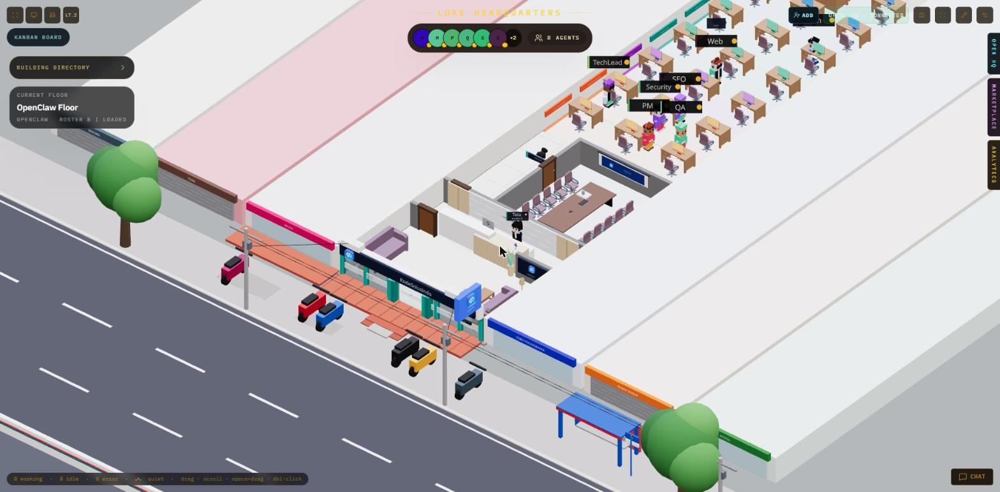
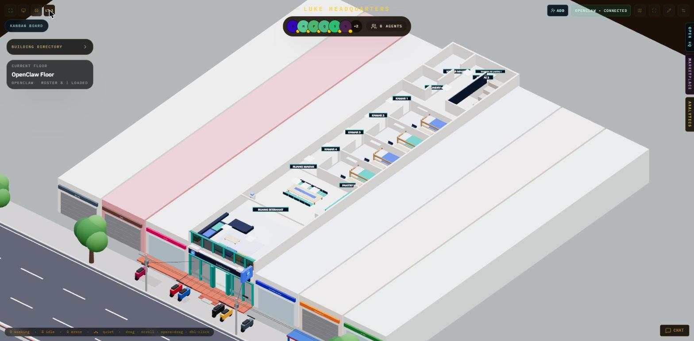
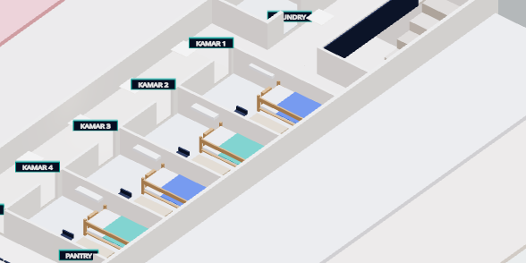
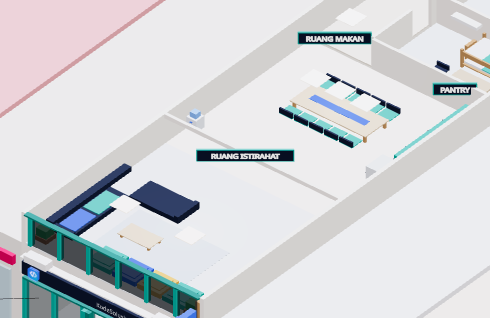

# Lantai 2 — Kantor AI KDS (denah & zonasi)

Desain teknis yang **disetujui owner** (KAN-5, 2026-11-12). Koordinat lokal ruko (x 0..348, y 0..1740;
y=0 dinding belakang, y=1740 fasad/jalan), sebelum offset `KDS_ORIGIN`.

## Skala & kunci

- 1 m = 58 satuan (`KDS_UNITS_PER_METER`), `SCALE = 0.018`.
- Tinggi lantai nyata **3,0 m** = `KDS_FLOOR_HEIGHT` (3,0 x 58 x 0.018 = 3,13 satuan dunia). Pelat L2 berada di ketinggian ini (KAN-10).
- `KDS_STORY = 1.05` tetap dipakai untuk dinding cutaway tampilan LT.1 (tidak berubah) dan dinding dalam L2 (cutaway agar isi ruangan terlihat).
- Perabot memakai skala vertikal stilisasi `Z_PER_M` = 0,36 per meter, sama dengan perabot Lantai 1.
- Lebar bangunan 6 m (x 0..348), panjang 30 m (y 0..1740).
- Partisi antar-ruang 6 satuan (0,10 m), dinding tepi 8 satuan.

## Denah zonasi

```text
x=0                 2 m         4 m         6 m
y=0    +-----------+-----------+-----------+
       | KAMAR     | HALL      | TANGGA    |
       | MANDI     | SERVIS    | (void)    |
y=3.3  +-----------+           |           |
       | LAUNDRY   |           |           |
y=5.7  +-----------+-----------+-----------+
       | B2 - hall penghubung              |
y=7.2  +-----------+-----------------------+
       | KORIDOR   | KAMAR 1  3.9x2.6      |
       | 2.0 m     +-----------------------+
       |           | KAMAR 2  3.9x2.6      |
       |           +-----------------------+
       |           | KAMAR 3  3.9x2.6      |
       |           +-----------------------+
       |           | KAMAR 4  3.9x2.6      |
y=18.0 +-----------+-----------------------+
       | RUANG MAKAN  6.0x6.07             |
y=24.1 +-----------------------------------+
       | RUANG ISTIRAHAT  6.0x5.86          |
y=30.0 +-----------------------------------+
                  ||  JALAN  ||
```

## Zona

| Kode | Zona | x0 | y0 | x1 | y1 | Ukuran (m) |
| --- | --- | --- | --- | --- | --- | --- |
| Z1 | Koridor utama | 0 | 420 | 116 | 1042 | 2,00 x 10,72 |
| Z2 | Hall servis (landing) | 124 | 0 | 234 | 330 | 1,90 x 5,69 |
| Z3 | Hall penghubung (B2) | 0 | 330 | 348 | 420 | 6,00 x 1,55 |
| Z4 | Kamar mandi bersama | 0 | 0 | 116 | 192 | 2,00 x 3,31 |
| Z5 | Laundry | 0 | 200 | 116 | 330 | 2,00 x 2,24 |
| Z6 | Tangga (void) | 240 | 0 | 342 | 330 | 1,76 x 5,69 |
| Z7 | Kamar 1 | 122 | 420 | 348 | 571 | 3,90 x 2,60 |
| Z8 | Kamar 2 | 122 | 577 | 348 | 728 | 3,90 x 2,60 |
| Z9 | Kamar 3 | 122 | 734 | 348 | 885 | 3,90 x 2,60 |
| Z10 | Kamar 4 | 122 | 891 | 348 | 1042 | 3,90 x 2,60 |
| Z11 | Ruang makan + pantry | 0 | 1048 | 348 | 1400 | 6,00 x 6,07 |
| Z12 | Ruang istirahat | 0 | 1400 | 348 | 1740 | 6,00 x 5,86 |

Void tangga (x 240..342, y 0..330) **tanpa slab** agar tangga L1 terlihat. Landing L2 di hall servis
y 0..70 (barat tangga), bukan di selatan.

## Signage (KAN-6)

| Teks | Posisi (x,y) | z |
| --- | --- | --- |
| KAMAR 1-4 | 120, S+35 (S = 420/577/734/891) | 0,62 |
| KAMAR MANDI | 120, 119 | 0,62 |
| LAUNDRY | 120, 269 | 0,62 |
| RUANG MAKAN | 58, 1060 | 0,70 |
| RUANG ISTIRAHAT | 174, 1410 | 0,95 |
| TANGGA KE LANTAI 1 | 237, 35 | 0,75 |
| LANTAI 2 | 237, 90 | 0,75 |

Palet: navy `#0b1f3a` (papan), teal `#16a596` (aksen), biru `#2563eb` (ikon), teks putih.

## Pencahayaan

- Maks 3 `pointLight` non-shadow (koridor 58,720; ruang makan 167,1179; lounge 174,1560).
- Sisanya panel emissive 0,6 x 0,6 m. Semua mesh L2 `castShadow={false}`.

## Batasan (wajib, lihat KAN-4)

- Layout/furnitur Lantai 1 **tidak diubah**.
- Namespace storage `kds-ruko-v10` **tidak dinaikkan**; toggle lantai memakai key terpisah `kds:office-level`.
- Tanpa kredensial/token/IP/email di commit.


## Kamar 1-4 (KAN-7)

- Furnitur per kamar (data di `scene/kdsKamarLayout.ts`, diuji di `tests/unit/kdsKamarLayout.test.ts`): bunk bed 2,0 x 1,0 m (116 x 58 satuan) rapat dinding timur/utara, lemari 1,2 x 0,55 m, meja 1,0 x 0,5 m + kursi + lampu baca, AC dinding.
- Dimensi horizontal nyata (1 m = 58 satuan). Tinggi dikompres 0,36 unit dunia per meter nyata karena KDS_STORY 1,05 mewakili satu lantai; semua furnitur lebih rendah dari dinding (1,05), jadi tidak menembus langit-langit.
- Pintu di dinding x 116..122 (y0+12..y0+58) menghadap koridor; area depan pintu bebas furnitur lantai.
- Signage KAMAR 1-4 digeser ke sisi koridor (x=96) dan dinaikkan di atas puncak partisi (z 1,3) agar teks penuh terlihat.
- Halaman dibuka dengan level tersimpan LT.2 -> kamera langsung memakai preset LT.2.
- Geometri kotak sederhana, tanpa bayangan, tanpa pointLight tambahan.


## Status implementasi (2026-11-12)

| Story | Isi | Status |
|---|---|---|
| KAN-6 | Pelat, dinding, koridor, tangga, 11 papan nama | Selesai, live |
| KAN-7 | Kamar 1-4: bunk bed, lemari, meja, AC | Selesai, live |
| KAN-8 | Ruang makan (meja + kursi) dan pantry (kitchen set) | Selesai, live |
| KAN-9 | Lounge: sofa L, meja kopi, karpet, TV dinding + konsol, bean bag, rak buku, tanaman; kaca fasad L2 gelap | Selesai, live |
| KAN-10 | Tombol LT.1/LT.2 (kiri atas), kamera LT.2, tinggi lantai nyata 3,0 m | Selesai, live |

### Perilaku tampilan

- **LT.1**: identik dengan versi sebelum Lantai 2 (dinding cutaway, susunan kursi pemilik, namespace layout `kds-ruko-v10` tidak berubah).
- **LT.2**: interior L1 disembunyikan; cangkang ruko (dinding keliling, tangga, fasad dengan etalase +-2 m dan papan nama tepat di bawah pelat L2) serta ruko tetangga tampil setinggi satu lantai penuh 3,0 m. Lantai 2 berdiri di atasnya.
- Pilihan lantai disimpan di `localStorage` kunci `kds:office-level` (terpisah dari kunci layout).

### Screenshot (office.profgsc.id)






### Deploy

Berkas yang berubah disalin dari `main` ke `/opt/claw3d/app` (pemilik `claw3d`), cadangan berkas lama + `.next` dibuat di `/root/backup-claw3d-<waktu>/`, lalu `npm run build` dan restart `claw3d-studio`.

### Catatan terbuka

- `kdsCats.tsx:80` (Lantai 1) punya error lint lama (`useMemo(buildGraph, [])`) — di luar lingkup Lantai 2.
- `KDS_DESK_COLUMNS` tidak terpakai di `kdsRuko.tsx` (warning lama).
